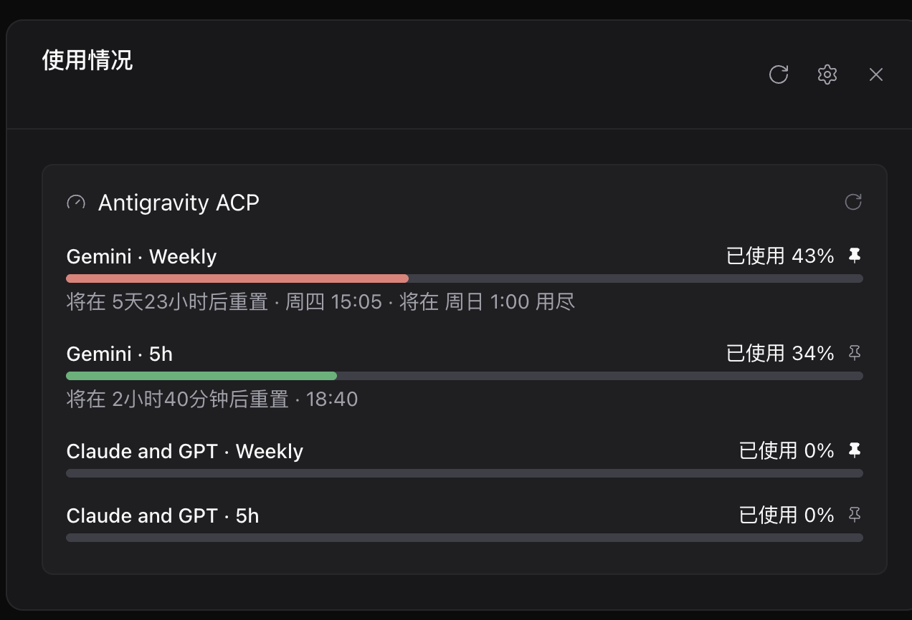

# 在 Paseo 查询 ACP 账号额度

`--usage` 可在终端独立查询额度，不需要插件。接入 Paseo 原生使用情况面板时，需要配套插件和 Paseo 0.17.4 或更新版本。数据来自官方 `agy_acp_server` 的 ACP `/usage`，不会调用 `agy` CLI。两者可以各自登录不同账号。

从 2.11.0 起，npm 包包含额度查询和可选插件。安装、同步升级和回滚见 [插件随 Release 发布](plugin-releases.md)。其中 `X.Y.Z` 需替换成实际发布版本，例如 `2.11.0`。

## 先验证 ACP 查询

在运行 provider 的同一台 daemon 主机上构建并查询：

```bash
npm ci
npm run build
node "dist/ACP Connector/main.js" --prepare-kernel
node "dist/ACP Connector/main.js" --usage
```

如果 provider 设置了 `GEMINI_HOME` 或 `PASEO_AGY_ACP_OFFICIAL_BIN`，终端查询也要设置相同值。额度查询会使用 ACP 自身的凭据目录 `<GEMINI_HOME>/antigravity-acp`；未设置 `GEMINI_HOME` 时默认为 `~/.gemini/antigravity-acp`。不要为查询额度切换到 CLI 登录，也不要把 CLI 的凭据复制过来。

返回 JSON 中 `remainingPct` 是剩余比例，`usedPct` 是已用比例，`resetsAt` 是 UTC 时间或 `null`。只有内核实际报告的百分比窗口才会显示；未提供的重置时间保持未知。周窗口和 5 小时窗口分别提供完整时长，供 Paseo 展示倒计时。当前 ACP 返回 Markdown，解析器针对内核 1.5.2 的格式；上游格式改变时需要重新验证。

查询创建独立短会话，不会占用正在工作的 agent，也不会把 `/usage` 加进业务对话。内核可能保留自己的短会话记录，并按原有机制刷新令牌。查询只在内核先声明支持 `/usage` 后发送该命令，不支持时直接失败。

## 适配器升级预检

插件每次刷新额度前，会对实际解析的适配器执行 `--version --capabilities`，仅在返回 `name: "paseo-agy-acp"` 和 `capabilities.accountQuota: 1` 时继续查询。普通 provider 可用性保留 Paseo 原生判断，不要求额度能力；旧适配器可以继续普通 ACP 使用，只在查询额度时提示升级。这个能力标记与版本号分开，避免把尚未发布的源码版本误判成已发布的同号旧包。

已发布的 2.10.0 认识 `--version`，会打印纯版本号并退出，不会因这个组合参数进入普通 ACP 启动。纯文本、畸形 JSON、不支持的能力版本、退出错误和超时都会中止预检，不再发送 `--usage`。不单独向旧版发送新探测开关。

错误提示会显示实际可执行文件或脚本路径，并根据目标 daemon 配置区分 `daemon PATH` 和 provider 指定的 `command`。应升级提示中的适配器；只更新插件或另一台主机上的全局命令无效。预检不会回显其他命令行参数或环境变量。

## 接入 Paseo 面板

使用 npm 发布版时，按[中文 README 的面板配置步骤](../../README.zh-CN.md#在-paseo-显示-acp-用量)安装插件、迁移 provider 并重载配置。安装及升级细节见[发布版安装](plugin-releases.md#用户从发布版本安装)。本地源码开发时，在目标 daemon 上启用插件后，从源码目录安装配套插件。

```bash
paseo plugin install /absolute/path/to/paseo-agy-acp/plugins/paseo-agy-acp
```

插件为受信任代码，可以访问 daemon 主机的文件、进程、凭据和网络。只有目标 daemon 已开启插件功能时才能加载；安装位置和 provider 配置都属于 daemon 主机。

插件默认启动 daemon `PATH` 上的 `paseo-agy-acp`。源码开发时，在 `agents.providers["paseo-agy-acp"]` 配置明确的启动路径：

```json
{
  "enabled": true,
  "command": ["node", "/absolute/path/to/paseo-agy-acp/dist/ACP Connector/main.js"],
  "env": {
    "GEMINI_HOME": "/absolute/path/to/acp-gemini-home"
  }
}
```

仅当已有 ACP 登录使用了独立 `GEMINI_HOME` 时填写该变量；默认账号可省略 `env`。保留实际使用的内核路径和其他环境设置。已有同名自定义 provider 配置应移除 `kind`、`extends` 字段，让插件注册 provider；保留 `command`、`env`、模型等所需配置。无需修改 Paseo 内置 `antigravity` provider。

用 `paseo reload --json` 加载 provider 配置，用 `paseo plugin ls` 确认插件运行。源文件更新后使用 `paseo plugin reload paseo-agy-acp`。打开「使用情况」，查看单独的 **Antigravity ACP** 卡片；刷新沿用相同的 provider 启动配置。



从 npm 安装适配器时，也可使用全局包内 `plugins/paseo-agy-acp` 的实际绝对路径安装，但它会被识别为目录来源，后续需手动更新适配器并 reload 插件。通过 npm 来源安装的插件由 `paseo plugin update` 管理。两种方式都需同步更新实际启动的适配器；仅查询额度不需要安装插件。

## 开发验证

```bash
npm test
npm ci --prefix plugins/paseo-agy-acp
npm --prefix plugins/paseo-agy-acp run typecheck
npm --prefix plugins/paseo-agy-acp test
```

配套插件测试使用 Node 22.6 及更新版本的类型擦除功能。协议测试验证只发送 `initialize`、`session/new`、`session/prompt`，且 prompt 精确为 `/usage`；未声明命令、认证错误和超时都会失败。插件测试验证 ACP 与 CLI 目录隔离及启动环境传递。

安装产物的真实验收使用 `node scripts/verify-paseo-quota-install.mjs --live`。先构建，使用原版 Paseo CLI 0.17.4 和已有 ACP 登录运行；也可用 `PASEO_QUOTA_SOURCE_HOME` 指向隔离账号的 daemon 配置目录。脚本从实际 tarball 安装插件，同时安装已发布 2.10.0，分别验证 PATH 和 provider 指定路径的普通 ACP 可用、额度查询单独提示升级，以及匹配版本的四个额度窗口。调用记录只用于判断额度刷新是否误启普通链路。

配置只写 `HOME`、`USERPROFILE`、`GEMINI_HOME`、`PASEO_AGY_ACP_OFFICIAL_BIN` 和本轮 `PASEO_HOME` 这些必要路径；代理和证书等网络设置仅通过子进程内存环境传递。脚本不继承 API key、无关令牌或 `NODE_OPTIONS`，不记录原始命令输出。正常结束、异常及退出信号都会清理本轮新建的临时工作目录，包括配置、daemon 密钥、日志、缓存和安装树；只在 `.tmp-quota-results` 保留脱敏结果。该脚本不自动运行于无账号 CI，也不修改生产 daemon。

本次实际安装路径、产物校验值、普通 ACP 与额度对照及环境清理结果见 [2026-11-26 兼容性验收记录](2026-11-26-acp-provider-compat-acceptance.md)。

Paseo 的接口依据：[provider 插件](https://paseo.sh/docs/plugins/providers.md)和[额度来源注册](https://paseo.sh/docs/plugins/reference.md#usage-sources)。
